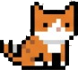

# 🐱 Desktop Pet Cat for Google Antigravity

A native macOS ambient desktop companion that lives on your screen and reacts to Google Antigravity in real-time.



---

## ✨ Features

- **Real-Time Antigravity States**:
  - **💻 Working**: Types energetically on a laptop while Antigravity is generating code or running tools. Stays typing until all parallel sessions finish.
  - **❓ Question**: Tilts its head with a gleaming question mark and plays a chime whenever Antigravity is waiting for human input (`ask_question`).
  - **🐾 Idle**: Sits peacefully, breathing and gently swishing its tail. Takes an autonomous 3–5 second local stroll every 35–60 seconds, then returns home.
  - **💤 Sleeping**: Curls up with floating cyan `z`s after 10 continuous minutes of inactivity.
- **Smart 1-Click Jump**:
  - Clicking the cat brings the Antigravity window to the front.
  - If a session is waiting for your input, clicking the cat automatically jumps directly to that specific conversation!
- **Multi-Monitor Support**:
  - Drag the cat freely across all connected displays without hitting an invisible border.
  - Right-click the cat to open the context menu and use **Move to Screen** to teleport it between monitors with 1 click.
- **Ultra-Lightweight & Battery-Friendly**:
  - Native Swift + AppKit implementation.
  - Steady-state CPU usage $< 0.7\%$, 0 disk I/O when idle.
  - Automatically pauses animations when screens sleep to preserve MacBook battery.

---

## 🚀 Installation

### Option 1: As an Antigravity Plugin

Clone or copy this repository into your Antigravity plugins directory:

```bash
mkdir -p ~/.gemini/config/plugins
git clone <your-repo-url> ~/.gemini/config/plugins/desktop-pet
```

Rebuild the binary once:
```bash
swiftc ~/.gemini/config/plugins/desktop-pet/main.swift -o ~/.gemini/config/plugins/desktop-pet/bin/DesktopPetCat
```

The plugin will automatically be recognized by Antigravity in the **Customizations** pane!

---

## 🛠 Project Structure

```
desktop-pet/
├── main.swift                 # Native AppKit macOS app source
├── plugin.json                # Antigravity plugin manifest
├── hooks.json                 # Antigravity lifecycle hooks
├── assets/                    # Logo and UI assets
├── skills/                    # Skill definition (/pet)
├── scripts/
│   ├── start_pet.sh          # Daemon launcher & compiler
│   ├── set_state.sh          # Hook handler entry point
│   ├── set_state.py          # Multi-conversation priority engine
│   └── switch_conversation.py # Active conversation switcher
└── sprites/                   # Pixel art animation frames
    ├── idle_1..12.png
    ├── working_1..12.png
    ├── question_1..8.png
    ├── walking_1..8.png
    └── sleeping_1..12.png
```

---

## 📄 License

Apache-2.0
